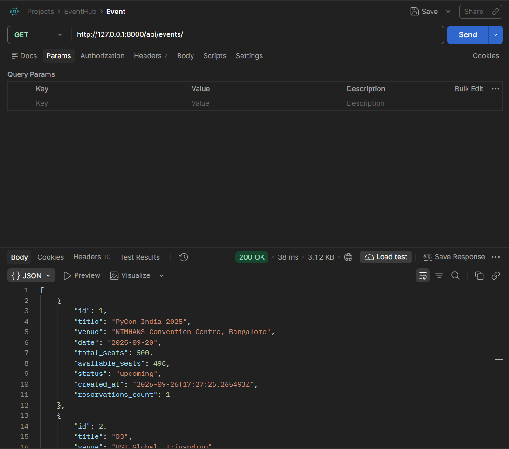
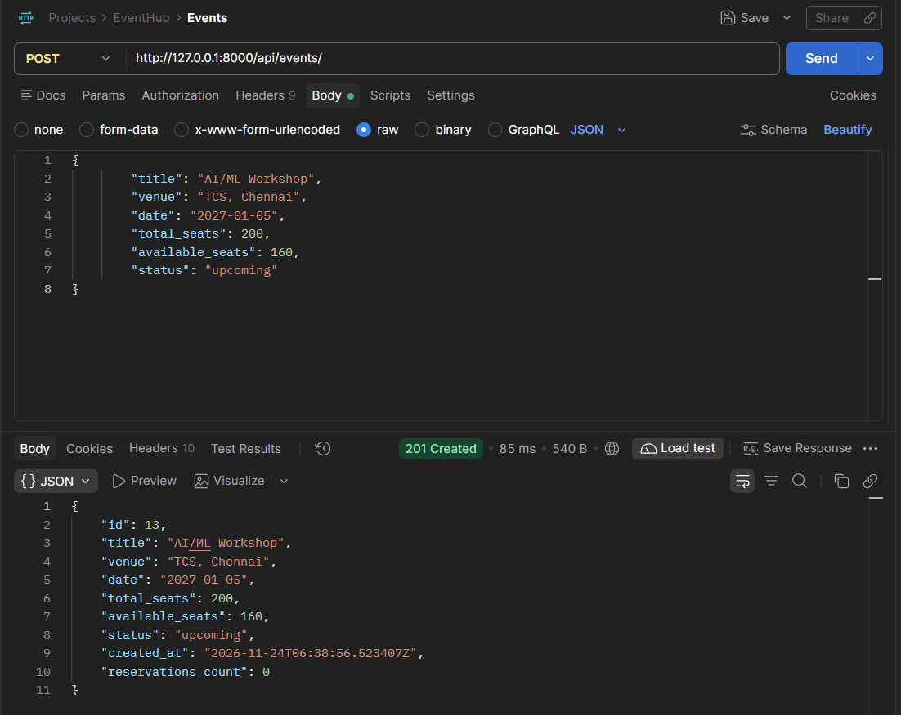
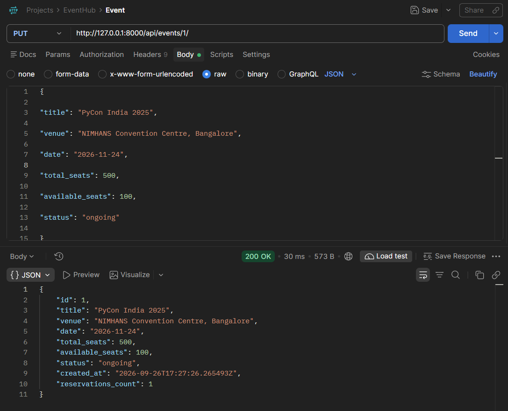
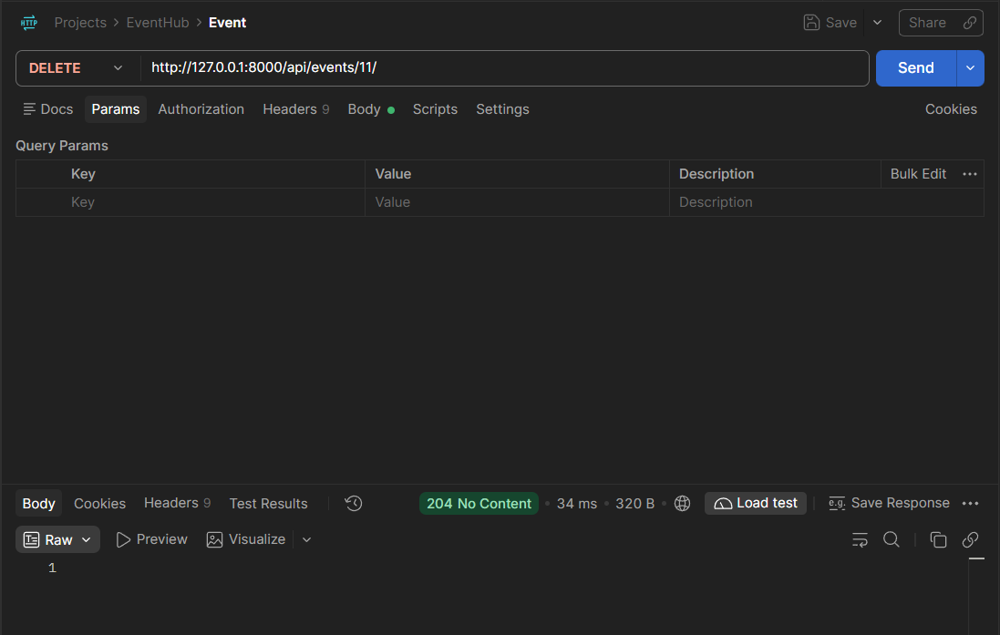
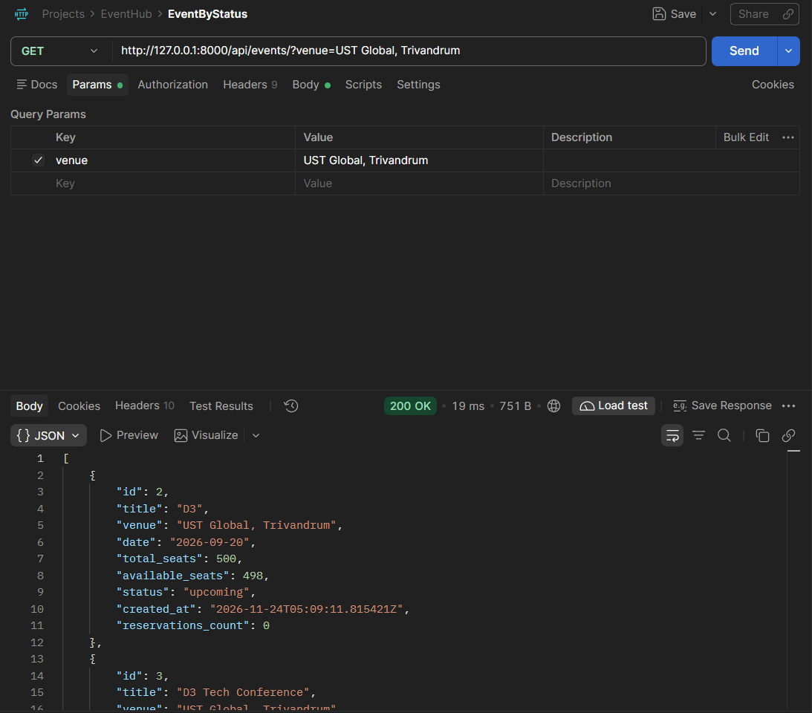
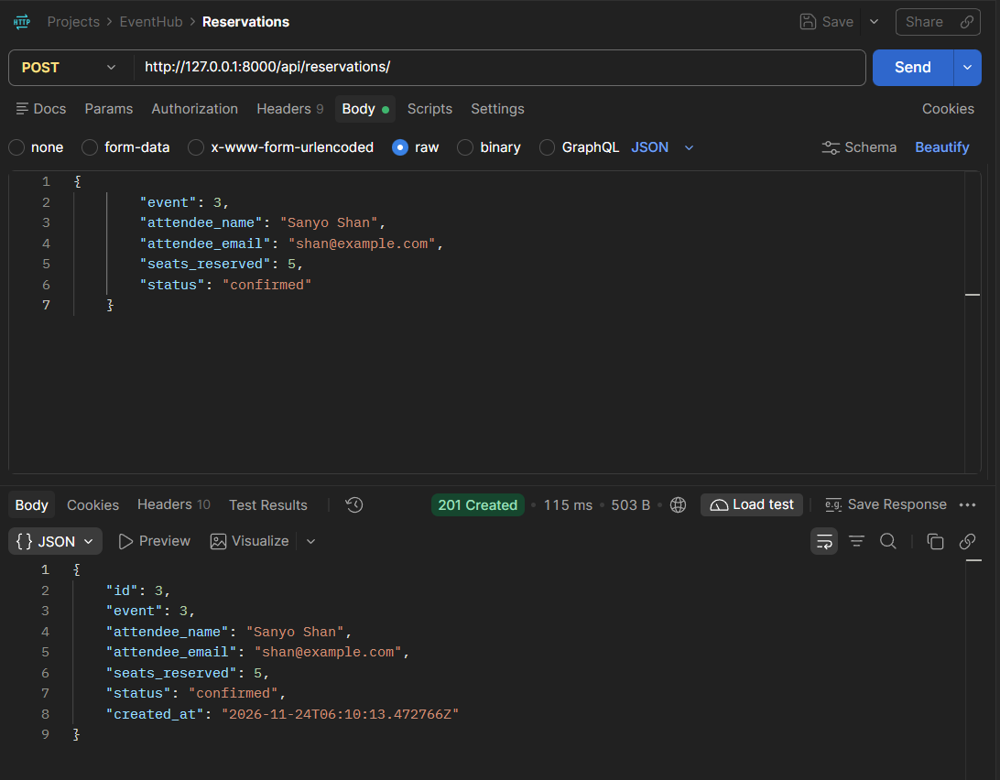
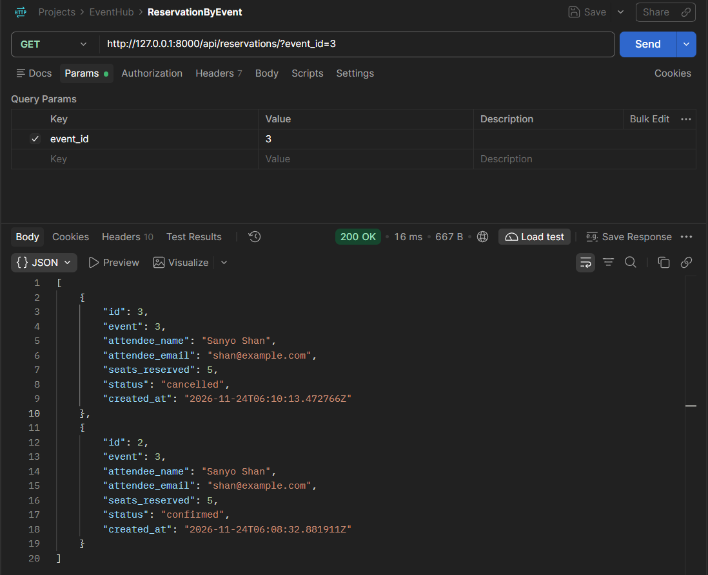
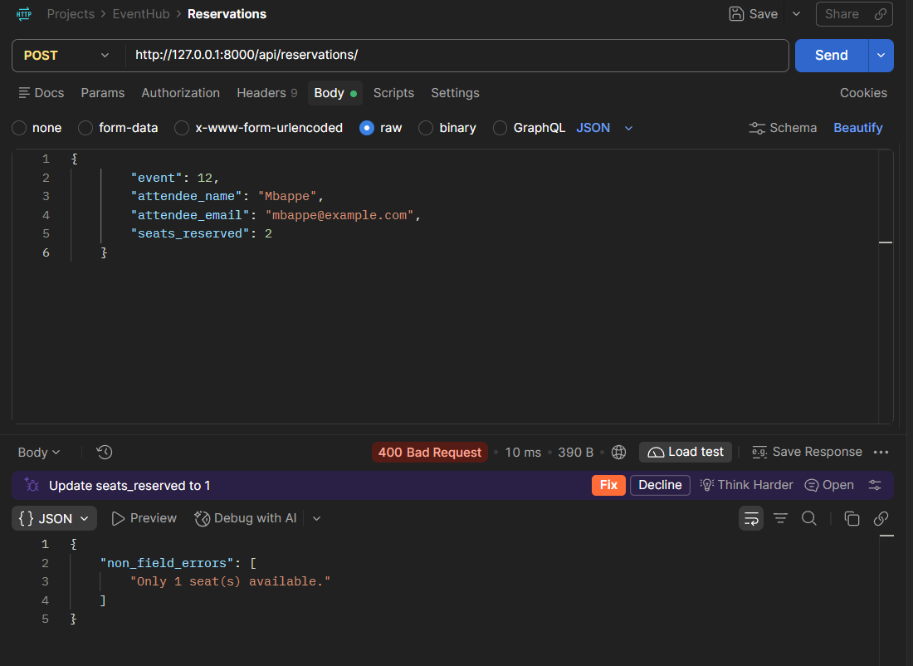
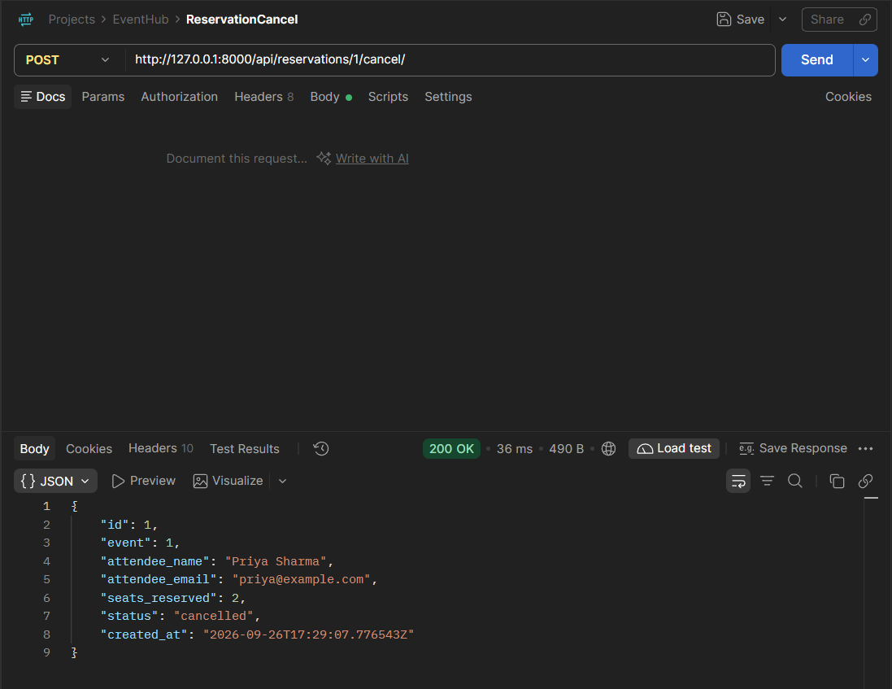

# EventHub – Event Ticketing API

## Overview

EventHub is a backend REST API for a simplified event ticketing platform, built using Django and Django REST Framework (DRF). It allows users to browse events, reserve seats and cancel reservations while managing seat availability.

## Features

- Event and reservation CRUD operations
- Filter events by status and venue
- Filter reservations by event ID
- Seat availability management
- Overbooking prevention
- Reservation cancellation and seat restoration

## Tech Stack

- Python
- Django
- Django REST Framework
- SQLite
- Postman (API testing)

## Getting Started

Open a terminal in the project root directory.

### 1. Install dependencies

```bash
pip install -r requirements.txt
```

### 2. Apply database migrations

```bash
python manage.py migrate
```

### 3. Start the development server

```bash
python manage.py runserver
```

Base URL: `http://127.0.0.1:8000/api/`

## API Endpoints

### Events

| Method | Endpoint | Description |
| --- | --- | --- |
| GET | `/events/` | Retrieve all events |
| GET | `/events/{id}/` | Retrieve a specific event |
| POST | `/events/` | Create an event |
| PUT | `/events/{id}/` | Update an event |
| PATCH | `/events/{id}/` | Partially update an event |
| DELETE | `/events/{id}/` | Delete an event |
| GET | `/events/?status=upcoming` | Filter events by status |
| GET | `/events/?venue=Chennai` | Filter events by venue |

### Reservations

| Method | Endpoint | Description |
| --- | --- | --- |
| GET | `/reservations/` | Retrieve all reservations |
| GET | `/reservations/{id}/` | Retrieve a specific reservation |
| POST | `/reservations/` | Reserve seats for an event |
| PUT | `/reservations/{id}/` | Update a reservation |
| PATCH | `/reservations/{id}/` | Partially update a reservation |
| DELETE | `/reservations/{id}/` | Delete a reservation |
| GET | `/reservations/?event_id=2` | Retrieve reservations for event 2 |
| POST | `/reservations/{id}/cancel/` | Cancel a reservation and restore seats |

## API Testing and Screenshots

The following screenshots demonstrate API requests and responses tested using Postman.

### Event Operations

#### Retrieve all events



#### Create an event



#### Update an event



#### Delete an event



#### Filter events by status


#### Filter events by venue



### Reservation Operations

#### Retrieve all reservations


#### Create a reservation

When a reservation is successfully created, the requested number of seats is deducted from the event's available seats.



#### Retrieve reservations by event



## Overbooking Prevention

The API validates the requested number of seats against the event's available seats before confirming a reservation.

```python
if event.available_seats < reservation.seats_reserved:
    # Reject the reservation
```

For example, if an event has 5 available seats and a user requests 8 seats, the reservation is rejected. No seats should be deducted for the rejected request.



## Reservation Cancellation Workflow

This scenario demonstrates how cancelling a reservation restores seats to the associated event.

### Step 1: Retrieve reservations for event 2

```http
GET /api/reservations/?event_id=2
```

Identify a confirmed reservation associated with event 2 and note its ID and number of reserved seats.


### Step 2: Check available seats before cancellation

```http
GET /api/events/2/
```

Note the current `available_seats` value.

### Step 3: Cancel the reservation

```http
POST /api/reservations/1/cancel/
```

This example assumes reservation 1 belongs to event 2 and is confirmed. The reservation is cancelled and its reserved seats are returned to the event.



### Step 4: Verify available seats after cancellation

```http
GET /api/events/2/
```

Verify that the available seats have increased by the number of seats in the cancelled reservation.

**Expected result (illustrative):**

| Field | Value |
| --- | ---: |
| Available seats before cancellation | 160 |
| Seats in cancelled reservation | 5 |
| Available seats after cancellation | 165 |

```text
Available seats after cancellation = Previous available seats + Cancelled seats
```

## Conclusion

EventHub demonstrates REST API development using Django REST Framework, relational data management, CRUD operations, filtering, business-rule validation and event seat management through reservation and cancellation workflows.

## 4. Design Decision

### Supporting Bulk Event Creation

By default, Django REST Framework's `ModelViewSet` supports 
creating a single object per POST request.

I decided to override the `create()` method in `EventViewSet` 
to support both single and multiple event creations through 
the same API endpoint.

### Implementation

```python
def create(self, request, *args, **kwargs):
    serializer = self.get_serializer(
        data=request.data,
        many=isinstance(request.data, list)
    )

    serializer.is_valid(raise_exception=True)
    serializer.save()

    return Response(serializer.data, status=201)
```

### Why this approach?

- Supports both single and multiple event creation.
- Reduces the number of HTTP requests required.
- Avoids creating a separate endpoint for bulk creation.
- Reuses the existing serializer and validation logic.
- Improves API flexibility and efficiency.

The `isinstance(request.data, list)` condition dynamically 
determines whether the serializer should process a single 
object or a list of objects.

This allows the same endpoint (`POST /api/events/`) to handle 
both individual and bulk event creation.